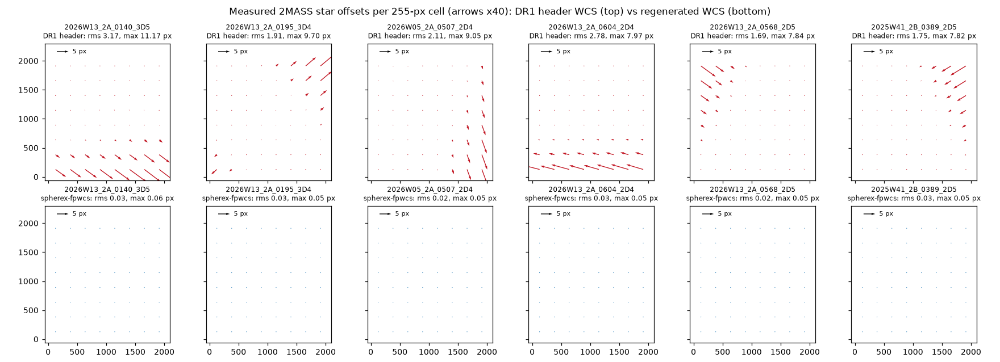

# spherex-fpwcs

Check and repair the astrometry (WCS) of SPHEREx Level-2 spectral images **without fitting stars**.

A small fraction of SPHEREx DR1 Level-2 images carry a WCS that is wrong by several pixels over
part of the detector while still being flagged as good (`FINAST = 0`). The six SPHEREx detectors
are rigidly mounted behind one telescope, so the WCS of all six in one exposure is fixed by a
single telescope attitude. `spherex-fpwcs` fits that attitude to the six header solutions of an
exposure, which exposes any detector that disagrees, and regenerates a correct WCS for it from a
fixed focal-plane template.

- Needs only FITS headers. Headers of the other five detectors are fetched from the public
  SPHEREx bucket with byte-range requests (about 40 kB each); no images are downloaded.
- Depends only on `numpy` and `astropy`.
- Accuracy against 2MASS stars: 0.02–0.07 px rms on 31 test images, including images whose DR1
  WCS was off by up to 11 px. See the [accuracy report](docs/report.md).

| | |
|---|---|
| [Project page](https://leejjoon.github.io/spherex-fpwcs/) | interactive demonstration: the sky under the old and new WCS |
| [User guide](#user-guide) | this page |
| [How it works](docs/technical.md) | algorithm, template, conventions |
| [Distortion and accuracy report](docs/report.md) | the DR1 problem, SPHEREx distortion, validation |



## User guide

### Install

```bash
pip install git+https://github.com/leejjoon/spherex-fpwcs
# or, from a checkout
pip install -e .
```

Python 3.10 or later, `numpy`, `astropy`.

### Check a file

```bash
spherex-fpwcs check level2_2026W13_2A_0568_2D5_spx_l2b-v27-2026-237.fits
```

```
exposure 2026W13_2A_0568_2  target detector D5
detectors used in fit: D1, D2, D3, D4, D5, D6   scale-1 = +88.8 ppm
header WCS vs focal-plane solution [pixels]:
  det    rms     max   area>1px  verdict
  D1   0.015   0.050     0.0%   consistent
  D2   0.057   0.292     0.0%   consistent
  D3   0.014   0.044     0.0%   consistent
  D4   0.019   0.085     0.0%   consistent
  D5   2.099  10.758    20.8%   INCONSISTENT <- target
  D6   0.012   0.035     0.0%   consistent
new WCS: TAN-SIP order 3, representation error 0.0008 px (forward), 0.0007 px (inverse)
```

Each row compares one detector's header WCS with the common six-detector solution, over a 12×12
grid that includes the detector corners.

| Verdict | Largest deviation | Meaning |
|---|---|---|
| `consistent` | below 0.3 px | normal; 98.6% of DR1 files in the week examined |
| `marginal` | 0.3–1 px | the header WCS is noticeably off near an edge or corner |
| `INCONSISTENT` | above 1 px | the header WCS is wrong over part of the detector |

`check` exits with status 0 if the target is below 1 px, 2 if it is above, and 1 on error.

### Get the corrected WCS

```bash
spherex-fpwcs header FILE              # header cards on stdout, the table above on stderr
spherex-fpwcs header FILE -o new.hdr   # cards to a text file
```

### Write a corrected FITS file

```bash
spherex-fpwcs apply FILE -o fixed.fits   # copy with the new WCS
spherex-fpwcs apply FILE --inplace       # modify FILE itself
```

`apply` replaces the celestial WCS in every image HDU that has one (`IMAGE`, `FLAGS`, `VARIANCE`,
`ZODI`). Pixel data, the spectral WCS (`...W` keywords, `WCS-WAVE` table) and the alternate pixel
WCS (`...A`) are left untouched. It adds these keywords to each updated HDU:

| Keyword | Content |
|---|---|
| `FPWCS` | `T`: the WCS was regenerated by this package |
| `FPWVER`, `FPWTMPL` | package version and template name |
| `FPWNDET` | number of detectors used in the attitude fit |
| `FPWSCALE` | fitted plate-scale offset in ppm (velocity aberration) |
| `FPWDMAX`, `FPWDRMS` | largest and rms shift between the original and the new WCS, in pixels |
| `HISTORY` | one line naming the detectors used |

### Where the other five headers come from

For a target file the other detectors of the same exposure are looked up in this order:

1. files given with `--sibling FITS` (repeatable);
2. local files in the target's directory, in `<dir>/<det>/`, in `<dir>/../<det>/` (the bucket
   layout), or under `--sibling-dir`;
3. the public bucket `s3://nasa-irsa-spherex`, release `dr1` (change with `--release`), first in
   the target's processing directory, then in the week's other directories such as `l2b_retry-*`.

`--offline` disables step 3. The target itself may also be an `s3://…` or `https://…` URL or a
bucket key such as `dr1/level2/2026W13_2A/l2b-v27-2026-237/5/level2_…fits`; then nothing is
downloaded except headers, and `check` / `header` work as usual.

### Options

| Option | Effect |
|---|---|
| `--exclude-self` | do not use the target's own WCS in the fit (the robust default gives the same answer to within 0.01 px in every case tested) |
| `--sip-order N` | order of the output SIP polynomial, default 3 as in DR1 |
| `--min-detectors N` | refuse to solve with fewer detectors, default 3 |
| `--release NAME` | bucket release to search, repeatable |
| `--template FILE` | use another template JSON |
| `--json` | print diagnostics as JSON |

### Python

```python
import spherex_fpwcs as fp

res = fp.solve("level2_2026W13_2A_0568_2D5_spx_l2b-v27-2026-237.fits")
print(res.summary())
res.diagnostics["target"]["max"]     # 10.76 (pixels)
res.header                           # astropy.io.fits.Header with the new WCS cards

from astropy.wcs import WCS
new_wcs = WCS(res.header)

fp.apply("level2_...fits", "fixed.fits")           # write a corrected copy

# no file discovery at all: pass the headers yourself
res = fp.solve(5, headers={1: h1, 2: h2, 3: h3, 4: h4, 5: h5, 6: h6})

# predicted sky position of any pixel of any detector of that exposure
ra, dec = res.attitude.predict(4, [0, 1019.5], [0, 1019.5])
```

### Limits you should know

- **At least three detectors of the exposure must be available**, and most of them must have a
  sound WCS. Exposures with two bad detectors out of six were tested and work; three or more bad
  detectors in one exposure were not encountered and are untested.
- **The template is derived from DR1 (processing v27) solutions** between April 2025 and May 2026,
  where it is stable to 0.01 px. Use on later data assumes the instrument has not changed.
- **Only the WCS is replaced.** `FINAST`, `OMEGA_MEDIAN` and other values derived from the old WCS
  are not recomputed, and downstream products made with the old WCS are not fixed.
- **Absolute zero point is inherited from DR1.** The template is the median of DR1 solutions, so
  any error common to all of them is carried over.
- It does not help when a whole exposure is mispointed in all six detectors in the same way.

### Tests

```bash
pip install -e .[test]
pytest                                   # offline
SPHEREX_FPWCS_NETWORK_TESTS=1 pytest     # also fetch headers from the bucket
```

The scripts used to build the template, scan DR1 and validate against stars are in
[`tools/`](tools/README.md).

## Licence

MIT, see [LICENSE](LICENSE).
