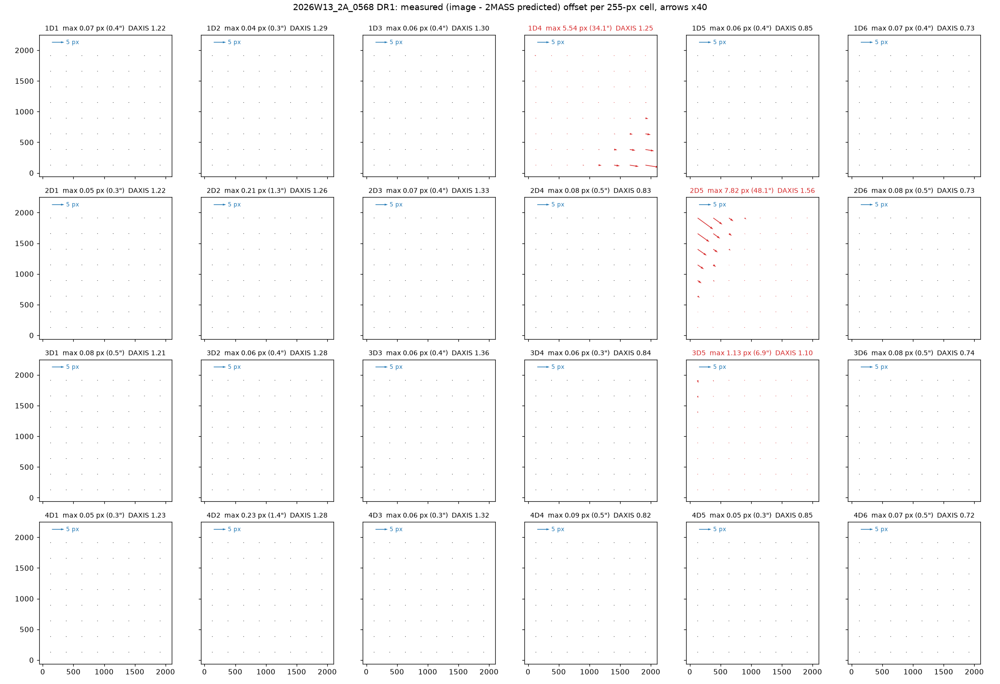
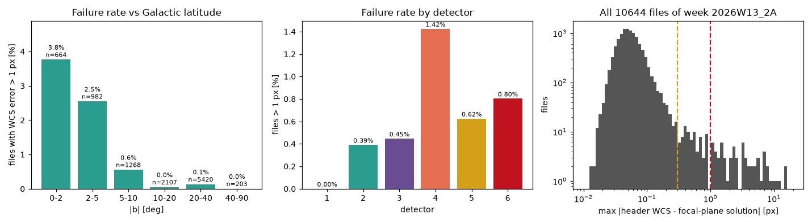
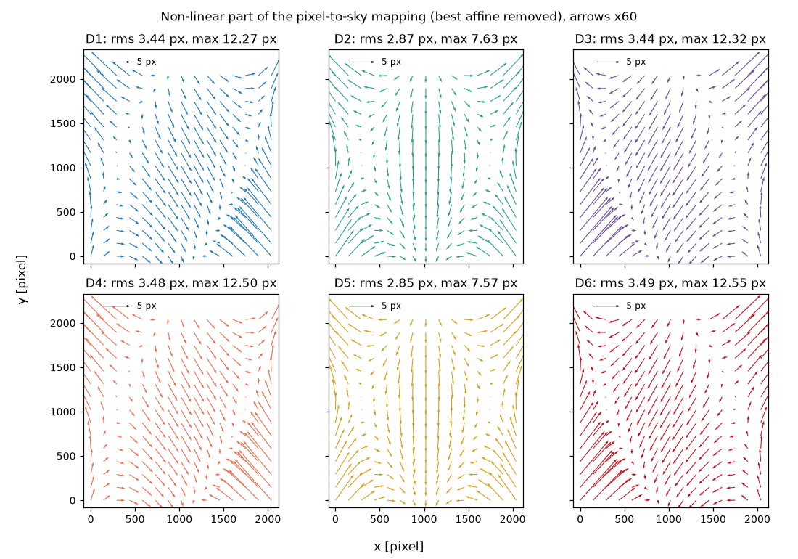
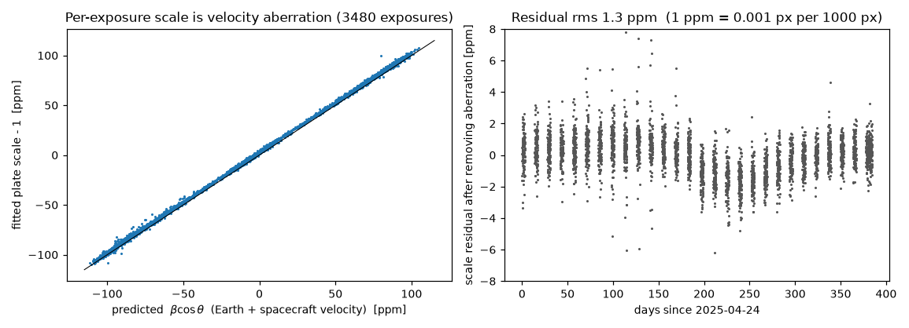
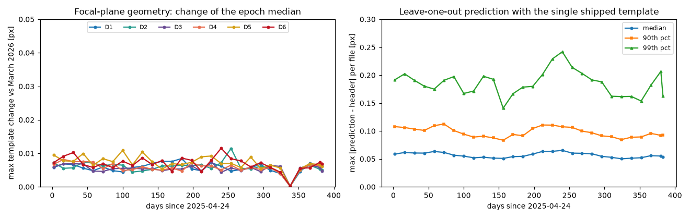
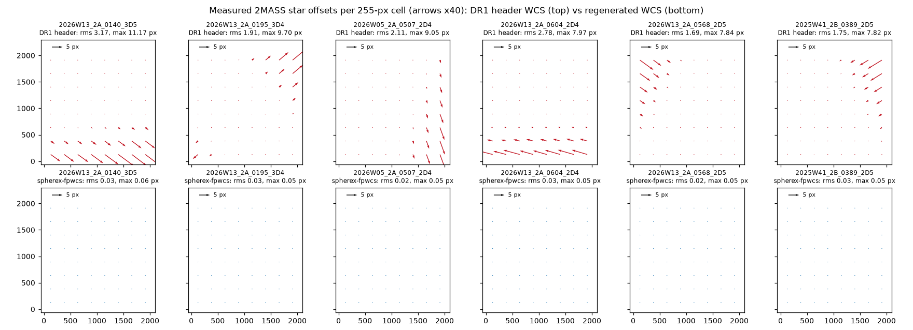

# SPHEREx distortion and the accuracy of star-free WCS repair

[Project page](https://leejjoon.github.io/spherex-fpwcs/) · [Repository](https://github.com/leejjoon/spherex-fpwcs)

Analysis of SPHEREx DR1 Level-2 spectral images (processing `l2b-v27`), November 2026.

## Summary

- **Problem.** About 0.25–0.6% of DR1 Level-2 images have a WCS that is wrong by 1–13 px over part
  of the detector, while flagged `FINAST = 0`. The rate reaches 3–4% within 5° of the Galactic
  plane. The error is entirely in the per-exposure distortion polynomial.
- **Instrument.** The optical distortion and the relative placement of the six detectors are
  constant to 0.01 px over the 13 months of DR1. Within each focal plane one common 5th-order
  distortion describes all three detectors to 0.01 px. The only per-exposure variables are the
  attitude and a plate scale that follows velocity aberration to 1.3 ppm.
- **Repair.** Fitting one attitude and scale to the six header WCS of an exposure and
  regenerating the WCS from a fixed template gives 0.02–0.07 px rms against 2MASS stars on 31
  test images, with no star fitting. That is the same as good DR1 solutions.

All position errors are in detector pixels (6.15″).

## 1. The problem in DR1

### 1.1 Origin of this work

This work started from a report by colleagues at KASI that
`level2_2026W13_2A_0568_2D5_spx_l2b-v27-2026-237.fits` has 2MASS stars displaced from their
predicted positions on one side of the detector, although `FINAST = 0`. Two more files of the
same pointing (`1D4`, `3D5`) show the same problem.

### 1.2 Measurement

For all 24 files of pointing `2026W13_2A_0568` the offset between detected sources and 2MASS
positions (K < 9.5) predicted by the header WCS was measured in an 8×8 grid of 255-px cells. In
each cell the offset is the peak of the histogram of all pairwise separations, which is robust to
crowding and to offsets of many pixels (`tools/measure_resid.py`).

| File | Worst cell | Peak at the corner | Area off by > 1 px |
|---|---|---|---|
| `0568_1D4` | 5.5 px (34″) | 8.0 px (49″) | 15% |
| `0568_2D5` | 7.8 px (48″) | 10.6 px (65″) | 20% |
| `0568_3D5` | 1.1 px (7″) | 1.6 px (10″) | 2% |
| other 21 files | ≤ 0.23 px | | |

Replacing only the SIP coefficients of a bad file with those of a good file of the same band, and
refitting pointing and the linear matrix, removes the error (rms 1.12 → 0.03 px for `1D4`,
1.68 → 0.04 px for `2D5`). The linear solution and the true distortion are fine; the fitted
distortion polynomial is not.

### 1.3 Why it is not flagged

From the pipeline source (`estimate_fine_astrometry.py`, checkout of June 2026; DR1 was produced
with v7.0.5, so details may differ):

- SCAMP fits a free 3rd-order distortion for every exposure, using 2,000–10,000 reference stars
  of magnitude 10–15, which are confusion-dominated in the Galactic plane.
- `FINAST = 0` requires SCAMP contrast > 2, `dAXIS1` and `dAXIS2` ≤ 1.5″ and
  `QS_NMATCH_VAR` < 0.15. The dAXIS values are residuals of stars SCAMP matched, within 15″ at low
  latitude. Stars in a region that is 30–65″ off are never matched and never count.

The quality metric is computed from the stars that agree with the solution, so it cannot see a
region where the solution is wrong.

### 1.4 How common it is

The package's attitude fit was run on headers only (`tools/pkg_scan.py`). "Deviation" is the
largest difference between a file's header WCS and the six-detector solution on a 12×12 grid.

| Sample | Files | > 0.3 px | > 1 px | > 2 px | > 5 px |
|---|---|---|---|---|---|
| Week `2026W13_2A`, all released files | 10,644 | 144 (1.35%) | 65 (0.61%) | 42 | 17 |
| 29 epochs, Apr 2025 – May 2026, 720 files each | 20,880 | 207 (0.99%) | 53 (0.25%) | 26 | 13 |

Week `2026W13_2A` contains many Galactic-plane pointings, hence its higher rate.

- **Latitude.** In week `2026W13_2A` the rate above 1 px is 3.8% at |b| < 2°, 2.5% at 2–5°, 0.6%
  at 5–10° and about 0.1% beyond. Failures at |b| = 21° and 30° were confirmed on images.
- **Detector.** Detector 4 is worst (1.42% in that week; 23 of 53 in the year sample), then 6 and
  5. Detector 1 had none in the week and 2 in the year sample.
- **Several at once.** Of 1,794 exposures in the week, 55 have one detector above 1 px and 5 have
  two. None has three.

### 1.5 Existing header keywords do not isolate the bad files

Tested on week `2026W13_2A` against the header-only metric (51 bad and 10,523 clean files on the
cell-centre grid used at that stage):

| Cut | Bad files caught | Clean files also flagged |
|---|---|---|
| `CONTRAST` < 40 | 31 of 51 | 320 (3.0%) |
| `CONTRAST` < 50 | 43 of 51 | 1,274 (12.1%) |
| `DAXIS` > band median + 0.15 | 43 of 51 | 108 (1.0%) |
| `DAXIS` > band median + 0.25 | 31 of 51 | 26 (0.2%) |
| `QS_NMATCH_VAR` > 0.10 | 12 of 51 | 67 (0.6%) |

## 2. The distortion of SPHEREx

### 2.1 Size and shape

The non-linear part of the pixel-to-sky mapping (after removing the best affine transform per
detector) is large: about 3 px rms and up to 12.5 px at the corners of the outer detectors.

| Detector | rms | max |
|---|---|---|
| 1 | 3.44 px | 12.3 px |
| 2 | 2.87 px | 7.6 px |
| 3 | 3.44 px | 12.3 px |
| 4 | 3.48 px | 12.5 px |
| 5 | 2.85 px | 7.6 px |
| 6 | 3.49 px | 12.6 px |

A WCS without the distortion term would therefore be wrong by many pixels, and a wrong distortion
term produces errors of the same order, as observed.

### 2.2 One distortion per focal plane

Each focal plane was modelled as three detectors placed rigidly (shift and rotation each) under a
single polynomial distortion. The residual is what a band-specific term would have to absorb
(`tools/focalplane.py`, template of week `2026W13_2A`):

| Common polynomial | Bands 1–3 (rms / max) | Bands 4–6 (rms / max) |
|---|---|---|
| Order 3 | 0.07–0.09 / 0.27 px | 0.10–0.13 / 0.41 px |
| Order 4 | 0.012–0.015 / 0.04 px | 0.023–0.030 / 0.07 px |
| Order 5 | 0.004–0.007 / 0.02 px | 0.008–0.014 / 0.06 px |

At order 5 no band-specific distortion is needed. The two focal planes do not share one
polynomial: a single one for all six detectors leaves 0.4 px rms. Their relative geometry is
nevertheless rigid, which is what the repair uses.

Caveat: the input is the median of the pipeline's own per-detector cubic fits. The result shows
that those fits are mutually consistent with a common polynomial; it is not an independent
measurement of the optics.

### 2.3 Rigidity within a week

Using all 1,794 exposures of week `2026W13_2A`, each detector was predicted from the other five
after fitting a per-exposure transformation, and compared with its own header WCS (clean files,
64 cell centres per detector):

| Per-exposure model | Median of max deviation | 99th percentile |
|---|---|---|
| Rotation and shift (3 parameters) | 0.15 px | 0.43 px |
| Plus one scale (4 parameters) | 0.035 px | 0.13 px |
| Full affine (6 parameters) | 0.036 px | 0.13 px |

### 2.4 The scale term is velocity aberration

For 3,480 exposures the fitted scale was compared with the first-order aberration prediction
β cos θ, θ being the angle between the boresight and the observer's barycentric velocity.

| Velocity used | Slope | Correlation | Scale rms after removal |
|---|---|---|---|
| none | | | 65.9 ppm |
| Earth orbital | 0.978 | 0.9969 | 5.2 ppm |
| Earth + spacecraft (`VX_SC`…) | 1.003 | 0.9998 | 1.3 ppm |

1 ppm is 0.001 px per 1000 px, so the scale is predictable to about 0.004 px across the 3-detector
field. In principle only the 3 attitude parameters need to be fitted; the package still fits the
scale so that it does not depend on an ephemeris.

### 2.5 Stability over 13 months

Per-detector distortion and six-detector templates were built separately for 29 epochs and
compared with the March 2026 epoch (`tools/longterm_analyze.py`).

| Quantity | Change relative to March 2026 |
|---|---|
| Per-detector distortion shape, largest change anywhere | 0.003–0.009 px |
| Shift of a whole detector in the focal plane | below 0.005 px |
| Six-detector template, largest change at any point | ≤ 0.01 px |

There is no trend and no seasonal term; the values are at the noise floor of a 120-exposure
median. Scale is excluded by construction (section 2.4).

The right-hand panel shows that the single shipped template predicts clean files equally well in
every epoch.

## 3. Accuracy of the repair

### 3.1 Against the DR1 solutions of clean files

For every clean file (deviation < 0.3 px), the WCS was predicted from the other five detectors
only and compared with the file's own header on the 12×12 grid including corners.

| Sample | Median of max | 90th pct | 99th pct |
|---|---|---|---|
| Week `2026W13_2A` (10,500 files) | 0.053 px | 0.092 px | 0.186 px |
| 29 epochs (20,673 files) | 0.057 px | 0.099 px | 0.190 px |
| Per epoch, range over the 29 | 0.050–0.065 px | | 0.14–0.24 px |

These numbers are upper limits on the prediction error, because they include the scatter of the
left-out DR1 solution itself.

### 3.2 Against stars

The definitive test: run the package on a file (siblings fetched from the bucket), then measure
2MASS star offsets on the image under the DR1 header WCS and under the regenerated WCS
(`tools/pkg_validate.py`). Values are rms / maximum over the 64 cells, in pixels.

**Bad files, March 2026**

| File | b | DR1 header | spherex-fpwcs | excluding own WCS |
|---|---|---|---|---|
| `2026W13_2A_0140_3D5` | +1.2° | 3.17 / 11.17 | 0.028 / 0.059 | 0.028 / 0.059 |
| `2026W13_2A_0195_3D4` | +2.7° | 1.91 / 9.70 | 0.029 / 0.053 | 0.029 / 0.053 |
| `2026W13_2A_0604_2D4` | −6.1° | 2.78 / 7.97 | 0.029 / 0.052 | 0.028 / 0.052 |
| `2026W13_2A_0568_2D5` | +0.9° | 1.69 / 7.84 | 0.024 / 0.051 | 0.024 / 0.051 |
| `2026W13_2A_0337_3D2` | +2.8° | 1.77 / 6.75 | 0.019 / 0.045 | 0.019 / 0.045 |
| `2026W13_2A_0568_1D4` | −2.6° | 1.12 / 5.54 | 0.025 / 0.045 | 0.025 / 0.047 |
| `2026W13_2A_0152_3D6` | −8.5° | 0.91 / 4.66 | 0.044 / 0.076 | 0.044 / 0.076 |
| `2026W13_2A_0263_1D6` | −20.9° | 0.51 / 2.67 | 0.055 / 0.094 | 0.055 / 0.093 |
| `2026W13_2A_0490_1D4` | −30.1° | 0.43 / 2.13 | 0.039 / 0.066 | 0.039 / 0.066 |
| `2026W13_2A_0568_3D5` | +1.0° | 0.24 / 1.13 | 0.023 / 0.050 | 0.024 / 0.051 |

**Bad files from other months**

| File | Date | b | DR1 header | spherex-fpwcs | excluding own WCS |
|---|---|---|---|---|---|
| `2025W29_2A_0296_1D5` | 2025-07-18 | +7.8° | 1.15 / 5.20 | 0.068 / 0.086 | 0.068 / 0.086 |
| `2025W33_2C_0292_3D4` | 2025-08-15 | −3.0° | 0.92 / 4.46 | 0.032 / 0.058 | 0.032 / 0.057 |
| `2025W37_2A_0608_1D2` | 2025-09-14 | +0.8° | 1.69 / 7.72 | 0.049 / 0.095 | 0.052 / 0.098 |
| `2025W39_2A_0523_1D4` | 2025-09-28 | −3.0° | 1.56 / 7.36 | 0.049 / 0.077 | 0.045 / 0.073 |
| `2025W41_2B_0389_2D5` | 2025-10-11 | +9.9° | 1.75 / 7.82 | 0.029 / 0.054 | 0.029 / 0.054 |
| `2026W05_2A_0507_2D4` | 2026-02-01 | +3.6° | 2.11 / 9.05 | 0.022 / 0.045 | 0.022 / 0.045 |
| `2026W09_2A_0612_2D4` | 2026-03-01 | +8.9° | 1.82 / 6.32 | 0.030 / 0.057 | 0.031 / 0.058 |
| `2026W11_2A_0537_3D4` | 2026-03-15 | −8.5° | 1.16 / 4.55 | 0.032 / 0.056 | 0.032 / 0.057 |

**Exposures with two bad detectors**

| File | Other bad detector | DR1 header | spherex-fpwcs |
|---|---|---|---|
| `2026W13_2A_0506_3D2` | D4 (3.1 px) | 1.08 / 5.00 | 0.023 / 0.042 |
| `2026W13_2A_0491_2D3` | D5 (5.0 px) | 0.85 / 3.75 | 0.039 / 0.071 |
| `2026W13_2A_0491_2D5` | D3 (5.6 px) | 0.71 / 3.46 | 0.024 / 0.062 |
| `2026W13_2A_0238_1D2` | D6 (3.1 px) | 0.75 / 3.75 | 0.026 / 0.063 |

**Clean controls**

| File | Date | b | DR1 header | spherex-fpwcs |
|---|---|---|---|---|
| `2025W17_4B_0006_2D3` | 2025-04-24 | −41.6° | 0.07 / 0.12 | 0.067 / 0.111 |
| `2025W35_2A_0001_1D6` | 2025-08-28 | −3.9° | 0.06 / 0.08 | 0.035 / 0.059 |
| `2025W51_2A_0012_3D1` | 2025-12-18 | −28.6° | 0.06 / 0.10 | 0.050 / 0.078 |
| `2026W13_2A_0018_1D1` | 2026-03-26 | −1.0° | 0.03 / 0.05 | 0.028 / 0.053 |
| `2026W13_2A_0568_1D1` | 2026-03-29 | −2.6° | 0.03 / 0.07 | 0.032 / 0.056 |
| `2026W13_2A_0568_2D3` | 2026-03-29 | +4.2° | 0.03 / 0.06 | 0.034 / 0.054 |
| `2026W13_2A_0568_3D6` | 2026-03-29 | +4.3° | 0.04 / 0.07 | 0.040 / 0.068 |
| `2026W13_2A_0568_4D5` | 2026-03-29 | +1.1° | 0.02 / 0.05 | 0.024 / 0.059 |
| `2026W13_2A_0670_3D2` | 2026-03-29 | +40.3° | 0.06 / 0.10 | 0.057 / 0.100 |

Over all 31 files the regenerated WCS has a median rms of 0.032 px (0.19″), a worst rms of
0.068 px and a worst single cell of 0.11 px. For clean files it is indistinguishable from the DR1
solution. Whether the target's own WCS takes part in the fit changes the result by at most
0.01 px.

### 3.3 What the residual floor contains

The 0.02–0.07 px floor is not purely the method's error. It includes centroiding noise of the
cell measurement, which grows where stars are sparse (the high-latitude controls show 0.06–0.07 px
for both the DR1 and the regenerated WCS), and 2MASS positions at epoch ~2000 used without proper
motions.

## 4. Limits of this study

- **Multiple failures.** Tested with two bad detectors of six. Three or more did not occur in the
  samples examined.
- **Pipeline version.** Everything refers to DR1 `l2b-v27` headers. The description of the
  pipeline logic comes from a source checkout that is not the exact DR1 version.
- **Sampling.** The year-long results use 29 of 110 half-week periods and 120 of roughly 1,700
  exposures in each. Image-level validation covers 31 files.
- **Reference frame.** The template is the median of DR1 solutions, so the regenerated WCS
  shares any systematic error common to them. Star validation used 2MASS only.
- **Cause.** Crowding is strongly associated with the failures but is not established as the
  only trigger: failures occur at |b| up to 30°, and neighbouring exposures of the same dense
  field can be fine.
- **Scope of the repair.** Only the WCS keywords are replaced. Quantities derived from the old
  WCS, and downstream products made with it, are not corrected.

## 5. Suggestions for the pipeline

1. Compare every fitted solution with the fixed band distortion (or the six-detector solution) and
   flag deviations above a few tenths of a pixel. This costs nothing and catches all cases found
   here.
2. Fix the distortion and solve only for attitude and scale, jointly for the six detectors of an
   exposure. The scale can even be taken from the ephemeris.

## 6. Reproduction

The scripts are in [`tools/`](../tools/README.md). The per-file scan results of section 1.4 are
produced by `tools/pkg_scan.py`, and the star validation of section 3.2 by `tools/pkg_validate.py`.
