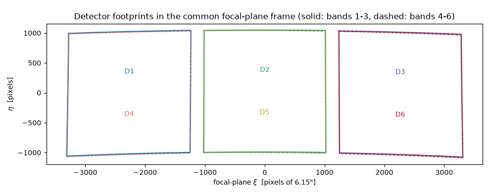
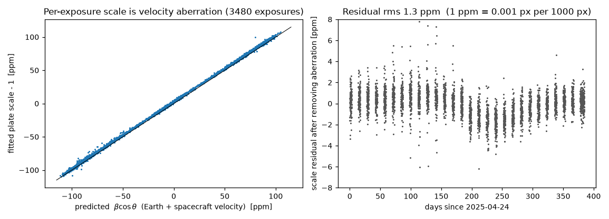

# How spherex-fpwcs works

[Project page](https://leejjoon.github.io/spherex-fpwcs/) · [Repository](https://github.com/leejjoon/spherex-fpwcs)

## 1. The idea

SPHEREx images the sky onto two focal planes behind a dichroic, each with three 2040×2040
detectors (bands 1–3 and bands 4–6). Bands 1 and 4, 2 and 5, and 3 and 6 see the same sky. All
six detectors are read out together, so one exposure produces six Level-2 files.

The DR1 pipeline solves the astrometry of each of those six files independently, with 6 linear
and 20 distortion coefficients per file fitted to stars. Yet physically the six solutions share
almost everything:

- the detectors do not move relative to each other, and the optical distortion does not change
  (measured: stable to 0.01 px over 13 months);
- the only things that differ from exposure to exposure are the telescope attitude (3 numbers)
  and the plate scale, which changes by up to ±100 ppm with velocity aberration (1 number).

So the 6 × 26 = 156 fitted coefficients of an exposure describe a system with 4 degrees of
freedom. This package uses that redundancy in two ways:

1. **Diagnosis.** Fit the 4 parameters to the six header solutions. A detector whose header
   disagrees with the common solution has a bad WCS.
2. **Repair.** Generate each detector's WCS from the 4 parameters and a fixed description of the
   focal plane (the *template*). The bad detector's own stars are never needed, because the other
   detectors pin down the attitude.

## 2. The template

The template describes where every pixel of every detector looks, in a frame fixed to the
instrument.

**Frame.** A unit vector frame with +z along the template boresight (the centre of the
six-detector footprint). A direction **v** is written in gnomonic plane coordinates
(ξ, η) = (v_x / v_z, v_y / v_z), in radians. The in-plane orientation is chosen so that the pixel
+x axis of detector 2 runs along +ξ.

**Representation.** For each detector, two 5th-order polynomials (21 terms each) give ξ and η as
functions of normalised pixel coordinates u = (x − 1019.5)/1020, v = (y − 1019.5)/1020, with x, y
0-based. These reproduce the gridded template to better than 0.001 px. The coefficients are in
`src/spherex_fpwcs/data/fp_template_v1.json` (252 numbers in total).

**Construction** (`tools/build_template.py`):

1. Take 3,480 complete six-detector exposures: 120 from each of 29 half-week periods spread
   evenly from 2025-04-24 to 2026-05-12 (`tools/longterm_fetch.py`). Only headers are read.
2. For each exposure evaluate the six DR1 header WCS on a 13×13 pixel grid, giving sky unit
   vectors.
3. Starting from one exposure as an initial guess, align every exposure to the current template
   with the attitude fit of section 3, map its points back into the template frame, and take the
   median over exposures at every grid point. Iterate; it converges after two rounds (change
   below 0.0002 px).
4. Normalise the scale so that the median exposure has scale 1, rotate the plane to the
   convention above, and fit the per-detector polynomials.

Because the template is a median over 3,480 exposures, the 0.25–0.6% of bad solutions in DR1 have
no influence on it.

**What it looks like.** Detector centres in the template plane, in units of 6.15″ pixels:

| Detector | ξ | η |
|---|---|---|
| 1 | −2265.5 | +0.2 |
| 2 | 0.0 | +27.6 |
| 3 | +2268.2 | −11.2 |
| 4 | −2269.6 | −11.5 |
| 5 | −2.1 | +17.5 |
| 6 | +2268.9 | −22.8 |

## 3. The attitude fit

Input: header WCS of N ≥ 3 detectors of one exposure. Output: a rotation **R**, an in-plane
similarity (2×2 matrix **M** = s·Rot(φ), shift **t**), and per-detector residuals
(`solve.fit_attitude`).

1. **Sample.** Evaluate each header WCS on a 12×12 pixel grid spanning the full detector
   (corners included), giving sky unit vectors **s**ᵢ. Evaluate the template at the same pixels,
   giving plane points **g**ᵢ and unit vectors **ĝ**ᵢ.
2. **Coarse rotation.** Solve the orthogonal Procrustes (Kabsch) problem for the rotation **R**
   minimising Σ|**s**ᵢ − **R** **ĝ**ᵢ|². This brings the sky into the template frame to within a
   few pixels even when some headers are bad.
3. **Robust refinement in the plane.** Project **R**ᵀ**s**ᵢ to plane coordinates **p**ᵢ and fit
   **p**ᵢ ≈ **M** **g**ᵢ + **t** by iteratively reweighted least squares, with Cauchy weights
   wᵢ = 1 / (1 + rᵢ² / r₀²), r₀ = 0.15 px, for 20 iterations. The closed-form weighted
   similarity solution is used at every iteration. Points where a header disagrees with the
   consensus by many times r₀ end up with negligible weight.
4. **Residuals.** For each detector, rᵢ = |**p**ᵢ − **M** **g**ᵢ − **t**| in pixels: rms, maximum,
   and fraction above 1 px. These are the numbers reported by `check`.

The rotation in step 2 and the in-plane rotation and shift in step 3 together are the 3-parameter
attitude; s is the scale. The prediction for pixel (x, y) of detector d is

  sky(x, y) = **R** · unit( **M** · template_d(x, y) + **t** , 1 )

**Why a scale term.** Fitting rotation and shift only leaves 0.15 px (median) of mismatch; adding
one scale brings it to 0.035 px; a full 6-parameter affine brings no further gain. The fitted
scale follows the first-order velocity-aberration prediction s − 1 = β cos θ (θ the angle between
the boresight and the observer's barycentric velocity, Earth plus spacecraft) with slope 1.003,
correlation 0.9998 and 1.3 ppm rms residual. The package fits the scale; it does not need an
ephemeris.

**Why the target can stay in the fit.** With robust weighting, the bad part of a bad detector is
ignored and its good part still contributes. In all 31 star-validated cases the result with and
without the target detector differs by at most 0.01 px. `--exclude-self` removes it explicitly.

## 4. Writing the new WCS

The prediction is an exact function, but FITS needs TAN-SIP keywords (`sip.fit_tan_sip`):

1. `CRPIX` = (1020.5, 1020.5), `CRVAL` = predicted sky position there.
2. Predict the sky on a 32×32 pixel grid and project it gnomonically about `CRVAL` to
   intermediate world coordinates in degrees.
3. Fit those coordinates as a polynomial in pixel offsets (linear terms plus orders 2…n, no
   constant). The linear part is the `PC`/`CD` matrix; the higher terms, multiplied by the inverse
   matrix, are the SIP `A_p_q`, `B_p_q`.
4. Fit the inverse polynomials `AP_p_q`, `BP_p_q` to order n + 1 on the same grid.
5. Verify by building an `astropy.wcs.WCS` from the new cards and comparing with the prediction
   on a different grid.

With the default n = 3 the representation error is about 0.001 px, forward and inverse (0.0008 px for the central detectors, 0.0013 px for the outer ones).

**Conventions compared with DR1 headers**

| | DR1 | spherex-fpwcs |
|---|---|---|
| Projection | `RA---TAN-SIP` / `DEC--TAN-SIP` | same |
| Linear terms | `PCi_j` with `CDELT = 1` deg | same (or `CDi_j` if the input used it) |
| `CRPIX` | usually 1020.5; 194 of 10,644 files elsewhere | always 1020.5 |
| SIP forward | order 3, includes constant and linear terms (`A_0_0`, `A_1_0`, …) | order 3, orders 2–3 only (standard) |
| SIP inverse | order 3 | order 4 |

`apply` updates existing keywords in place, inserts new ones next to them, and deletes primary
celestial WCS keywords that are not in the new set, so no stale SIP terms remain. Keywords of the
alternate systems (`CRPIX1A`, `CTYPE1W`, …) do not match and are untouched.

## 5. Finding and reading the other headers

File names encode the exposure: `level2_{week}_{sequence}_{slew}D{detector}_spx_{processing}.fits`.
The other detectors differ only in the detector digit and, for reprocessed files, in the
processing string and directory (`l2b_retry-…`).

Remote access uses anonymous HTTPS to `https://nasa-irsa-spherex.s3.amazonaws.com/` with the
standard library:

- one `ListObjectsV2` request lists the processing directories of the week;
- each header is read with a `Range: bytes=0-40319` request. The primary HDU of a Level-2 file
  has no data, so the image header follows immediately; the range is doubled if the `END` card is
  not found.

A complete run for one file makes about 6–11 small requests and takes a few seconds.

## 6. What the method cannot do

- **Fewer than three usable detectors.** DR1 only releases files with `FINAST = 0`, so some
  exposures have fewer than six files. In the week examined every exposure had at least three and
  97% had all six.
- **A majority of bad headers.** The robust fit follows the consensus. Two bad detectors out of
  six are handled (tested on stars); more were not encountered in DR1 and are untested.
- **Errors common to all DR1 solutions.** The template is defined by DR1 medians, so the absolute
  reference is the pipeline's.
- **Changes of the instrument.** A physical shift of a detector or of the optics after May 2026
  would require a new template; `check` would show it as a persistent, uniform inconsistency of
  one detector in every exposure.
- **Sub-0.03 px structure.** The per-exposure DR1 solutions scatter by about 0.03–0.05 px around
  the template; the method cannot say whether that scatter is noise in the DR1 fit or real.

## 7. Module map

| Module | Content |
|---|---|
| `template.py` | template loading and evaluation |
| `solve.py` | header → WCS, Kabsch rotation, robust similarity, `Attitude` |
| `sip.py` | prediction → TAN-SIP header |
| `remote.py` | file-name parsing, bucket listing, ranged header reads |
| `api.py` | `solve`, `check`, `apply`, header gathering and replacement |
| `cli.py` | `spherex-fpwcs` command |
